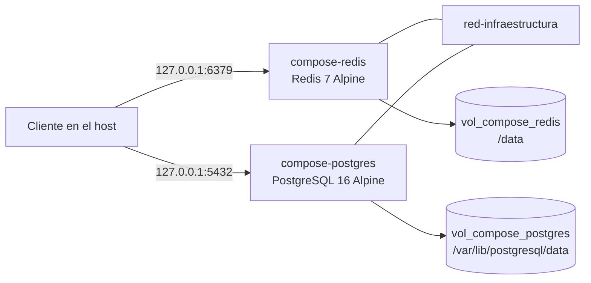

# Laboratorio 1. Contenedores locales con Docker

**Curso:** Integración de Sistemas y Plataformas  
**Estudiante:** Genesis Bailon Anchundia  
**Cuenta:** [Genesis12-hub](https://github.com/Genesis12-hub)

## Objetivo

Dejar en marcha, en la máquina local, una caché Redis 7 y una base PostgreSQL 16, y comprobar que los datos sobreviven al recrear los contenedores porque viven en volúmenes.

## Alcance

Este repositorio contiene la infraestructura del laboratorio 1: el archivo Compose, el ejercicio manual en PowerShell y la evidencia de la ejecución. La aplicación .NET 10 con Aspire es el laboratorio 2 y vive en otro repositorio.

La comprobación del 7 de noviembre de 2026, limitada a un `PONG` de Redis, permanece en [`docs/validacion-linux.txt`](docs/validacion-linux.txt). El ejercicio completo se ejecutó el 8 de noviembre de 2026. La transcripción está en [`docs/validacion-lab1-linux.txt`](docs/validacion-lab1-linux.txt).

## Arquitectura

El proceso cliente llega a cada servicio por el loopback. Los dos servicios se ven entre sí por la red `red-infraestructura`. Cada uno guarda sus datos en su volumen.



El ejercicio manual usa otro volumen, `vol_redis_datos`, primero en `infra-redis` y después en `infra-redis-recuperado`. Ese volumen no pertenece al proyecto Compose.

Redis arranca con `redis-server --appendonly yes` en el script y en Compose. El informe final del video no repetía esa opción dentro de Compose; se conserva para que el reinicio quede registrado en disco. Los puertos de la clase son 6379 y 5432; en este trabajo se publican solo en `127.0.0.1`.

## Requisitos y evidencia

| Requisito | Dónde se cumple | Evidencia ejecutada |
| --- | --- | --- |
| Imágenes `redis:7-alpine` y `postgres:16-alpine` | [`scripts/infraestructura.ps1`](scripts/infraestructura.ps1) | [captura de imágenes y volumen](docs/capturas/01-imagenes.png) |
| Volumen `vol_redis_datos`, inspección y listado | mismo script | [captura de imágenes y volumen](docs/capturas/01-imagenes.png) |
| `infra-redis` con AOF, reinicio `unless-stopped` y puerto 6379 | mismo script | transcripción y [recuperación](docs/capturas/02-recuperacion-mismo-volumen.png) |
| `PING`, `SET`, `GET` y `SAVE` con valores de muestra | mismo script | [captura de imágenes y volumen](docs/capturas/01-imagenes.png) |
| Listado de `appendonlydir` | carpeta [`.backup_redis/`](.backup_redis/.gitkeep) | [captura de imágenes y volumen](docs/capturas/01-imagenes.png) |
| Nuevo contenedor con el mismo volumen y la clave leída de nuevo | `infra-redis-recuperado` | [recuperación por el mismo volumen](docs/capturas/02-recuperacion-mismo-volumen.png) |
| Compose con servicios, volúmenes y redes en la raíz | [`infra/docker-compose.yaml`](infra/docker-compose.yaml) | `docker compose config` en la transcripción |
| Contenedores `compose-redis` y `compose-postgres`, reinicio `unless-stopped` | mismo archivo | [consultas](docs/capturas/05-compose-consultas.png) |
| Volúmenes `vol_compose_redis` y `vol_compose_postgres`, red bridge `red-infraestructura` | mismo archivo | transcripción |
| Usuario `usuario_uleam` y base `db_integracion` | mismo archivo y `infra/.env` | [consultas](docs/capturas/05-compose-consultas.png) |
| Redis sano, `PONG` y lectura posterior | Compose | [persistencia y limpieza](docs/capturas/06-compose-persistencia.png) |
| `SELECT version()` y `SELECT 1` | Compose | [consultas](docs/capturas/05-compose-consultas.png): PostgreSQL 16.15 y `uno = 1` |
| Datos vivos tras `down` y `up` | ambos servicios | [persistencia y limpieza](docs/capturas/06-compose-persistencia.png): `muestra-compose` y la fila `persistencia-postgres` |
| `down -v` limitado a este proyecto | Compose, proyecto `lab1-infraestructura` | [persistencia y limpieza](docs/capturas/06-compose-persistencia.png): queda `vol_redis_datos` |

## Inicio en Windows con PowerShell

Hace falta Docker en la máquina. En la carpeta del repositorio:

```powershell
Copy-Item infra\.env.example infra\.env
notepad infra\.env
.\scripts\infraestructura.ps1
docker rm -f infra-redis-recuperado
docker compose -p lab1-infraestructura --env-file infra\.env -f infra\docker-compose.yaml up -d
```

En `infra\.env` hay que sustituir `REEMPLAZAR_CON_CONTRASENA_LOCAL`. Ese marcador no es una contraseña de uso. La contraseña real no se guarda en Git. El script manual, al terminar, deja `infra-redis-recuperado` escuchando en `127.0.0.1:6379`; por eso se retira ese contenedor antes de levantar Compose. El volumen `vol_redis_datos` se conserva.

Estos comandos son el procedimiento para repetir el trabajo en Windows. La corrida archivada en este repositorio se hizo con PowerShell 7.6.9 sobre Ubuntu 24.04.5 LTS, kernel 6.12.113+, Docker Engine 29.9.3 y Compose v5.7.0. El video de clase usa Windows y WSL2; la transcripción de este repositorio es de Linux.

## Persistencia y copia

La recuperación pedida usa el mismo volumen. Se borra el contenedor y se crea otro montando `vol_redis_datos`. La clave `lab1:muestra` volvió a leerse: `persistencia-volumen-local`.

`docker cp` de `appendonlydir` con Redis en marcha solo produjo el listado de archivos. Esa copia no se versiona y no se presenta como un respaldo consistente. La opción `-VerificacionExtraRespaldo` hace otra prueba: el servidor se detiene, la copia se carga en un volumen vacío y Redis responde en `127.0.0.1:16379`. Esa prueba es adicional. El contenedor y el volumen temporales se eliminan al acabar.

## Limpieza

`docker compose -p lab1-infraestructura down -v` borra los contenedores, la red `red-infraestructura` y los volúmenes `vol_compose_redis` y `vol_compose_postgres`. El aviso quedó en la transcripción. El comando no hace un `prune` de todo el Docker de la máquina. Después de la limpieza, `vol_redis_datos` seguía presente.

## Laboratorio 2

El laboratorio 2 es una aplicación .NET 10 con Aspire, en otro repositorio. Aspire describe sus propios recursos y los levanta cuando esa aplicación se ejecuta. Este Compose es la práctica de contenedores del laboratorio 1.

Guardar este código en GitHub, o más adelante en Azure DevOps, publica los archivos. Ese alojamiento no ejecuta `compose-redis` ni `compose-postgres`, y Aspire no queda obligado a reutilizar estos contenedores.

## Entrega

La entrega del laboratorio 1 es la URL del repositorio. El proyecto de Azure DevOps previsto para el mismo código todavía no recibe esta publicación. El acceso de lectura del docente no está configurado.

## Referencias

- [Docker Engine en Ubuntu](https://docs.docker.com/engine/install/ubuntu/)
- [Docker Compose](https://docs.docker.com/compose/)
- [Imagen Redis](https://hub.docker.com/_/redis)
- [Imagen PostgreSQL](https://hub.docker.com/_/postgres)
